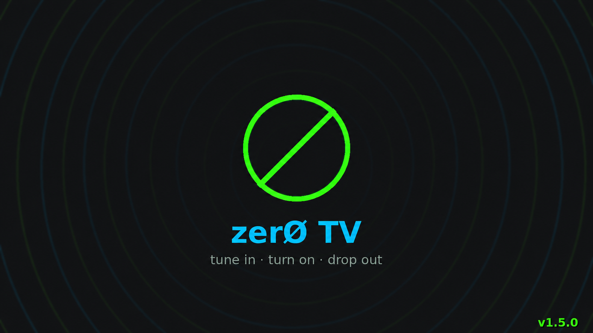
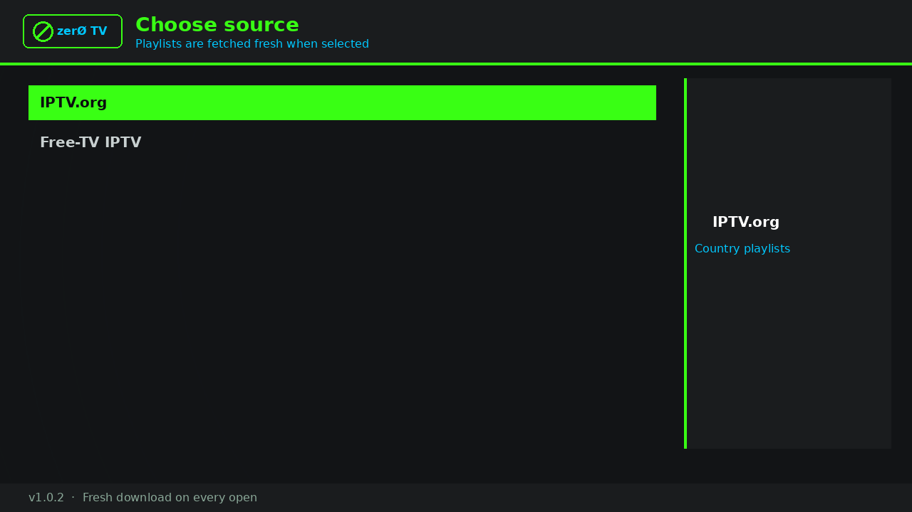

<p align="center">
  
</p>

<h1 align="center">zer0 TV</h1>

<p align="center">
  <b>Sideloaded IPTV channel browser for Roku</b><br/>
  <sub>v1.0.2 · BrightScript / SceneGraph</sub>
</p>

<p align="center">
  Browse public IPTV playlists by country, search channels, and play HLS streams on your Roku device.
</p>

---

## Screenshots

<p align="center">
  
</p>

<p align="center"><i>Source picker — IPTV.org and Free-TV, dark neon UI</i></p>

## Features

- **Source picker** on launch — choose a playlist provider
- **Fresh downloads** when you open a source or country (cache only as network fallback)
- **Country → channel** navigation with left/right letter jump
- **On-screen search keyboard** (no phone/QR keyboard)
- **Options** menu: search, group filter, favorites
- **Preview panel** with logos / flags on focus
- **Player** with optional closed captions control
- Splash branding with **v1.0.2**

## Playlist sources

zer0 TV does **not** fork or vendor upstream repositories. At runtime it requests
playlist files that those projects already publish on the web.

| Source | Role | Upstream license | Link |
|--------|------|------------------|------|
| **IPTV.org** | Country `.m3u` playlists | [Unlicense](https://github.com/iptv-org/iptv/blob/master/LICENSE) | [iptv-org/iptv](https://github.com/iptv-org/iptv) |
| **Free-TV IPTV** | Global `playlist.m3u8` | No license file in repo (see [THIRD_PARTY.md](THIRD_PARTY.md)) | [Free-TV/IPTV](https://github.com/Free-TV/IPTV) |

Endpoints used:

- `https://iptv-org.github.io/iptv/countries/{code}.m3u`
- `https://raw.githubusercontent.com/Free-TV/IPTV/master/playlist.m3u8`

Upstream legal notes (IPTV.org): playlists are collections of links to streams, not
hosted video files. See their [Legal](https://github.com/iptv-org/iptv#legal) section.

Stream availability varies by region, network, and rights holders. This app does not
host or re-encode video content. Full third-party notes: [THIRD_PARTY.md](THIRD_PARTY.md).

## Releases

| File | Use |
|------|-----|
| `releases/zer0tv-v1.0.2-roku.zip` | **Upload to Roku** (developer app installer) |
| `releases/zer0tv-v1.0.2-roku.zip.sha256` | SHA-256 checksum for the Roku zip |
| `releases/zer0tv-v1.0.2-source.7z` | Full source archive for GitHub / backup |
| `releases/zer0tv-v1.0.2-source.7z.sha256` | SHA-256 checksum for the source archive |

Verify a download (Linux/macOS):

```bash
sha256sum -c zer0tv-v1.0.2-roku.zip.sha256
sha256sum -c zer0tv-v1.0.2-source.7z.sha256
```

## Install on Roku

### 1. Enable Developer Mode

1. On the Roku remote, press: **Home** three times, then **Up** twice, then **Right**, then **Left**, then **Right**, then **Left**, then **Right**.
2. On the developer screen:
   - Set **Installer password** (write it down)
   - Enable **Developer mode** / install apps
   - Note the **IP address** shown (example: `192.168.1.50`)
3. Restart if prompted.

Official reference: [Roku Developer Setup](https://developer.roku.com/docs/developer-program/getting-started/developer-setup.md)

### 2. Sideload the channel

1. On a computer on the **same Wi‑Fi** as the Roku, open a browser to:

   ```text
   http://ROKU_IP
   ```

   Example: `http://192.168.1.50`

2. Log in:
   - Username: `rokudev`
   - Password: the **installer password** you set

3. Under **Upload** / development application installer:
   - Choose `releases/zer0tv-v1.0.2-roku.zip` (or the zip from this repo root packaging)
   - Click **Install**

4. When install succeeds, **zer0 TV** appears in your Roku app list (or starts automatically).

Re-uploading the same package **replaces** the previous sideload.

### 3. First launch

1. Splash shows **v1.0.2**
2. Pick **IPTV.org** or **Free-TV IPTV**
3. Open a country / region, then a channel

**Back** navigates: player → channels → countries → sources.

## Controls

| Remote | Action |
|--------|--------|
| OK | Select / play |
| Back | Go up one level |
| Left / Right | Jump by letter (lists) |
| * (Options) | Channel options / search; during playback opens player options |
| Replay | Search: delete character |

## Project layout

```text
zer0tv/
├── README.md
├── LICENSE
├── CHANGELOG.md
├── manifest
├── source/           # main.brs entry
├── components/       # SceneGraph + BrightScript
├── images/           # splash, icons, UI art
├── assets/           # README images
├── docs/
└── releases/         # packaged zip / 7z
```

## Build the Roku zip yourself

From this folder (package **contents** at zip root, not a nested folder):

```bash
zip -r releases/zer0tv-v1.0.2-roku.zip manifest source components images
```

## Disclaimer

zer0 TV is a playlist browser/player for publicly published IPTV lists. You are responsible for complying with laws and terms that apply in your region. Channels may fail if streams are geo-blocked, offline, or restricted.


## Custom builds

Want branding, extra sources, private playlists, or other features?

**[Contact form](https://snuffy420.github.io/zer0TV/docs/contact.html)** — no public email on this page.


## Support zer0 TV

If zer0 TV is useful to you, consider supporting development with a Bitcoin donation. Donations are optional and appreciated.

**Bitcoin (BTC):** `bc1qz8877p6vusc22qrctdj4h7w0uk2l9l9h8lwphy`

## License

**zer0 TV** (this application's source code) is licensed under the
**[GNU General Public License v3.0](LICENSE)** (GPL-3.0).

That license applies to the Roku channel code in this repository. It does **not**
re-license upstream playlists, channel metadata, logos, or the streams themselves.

Third-party playlist projects remain under their own terms:

- **IPTV.org** — [Unlicense](https://github.com/iptv-org/iptv/blob/master/LICENSE)
- **Free-TV/IPTV** — see [THIRD_PARTY.md](THIRD_PARTY.md)

See also [THIRD_PARTY.md](THIRD_PARTY.md) and the [Disclaimer](#disclaimer) above.
