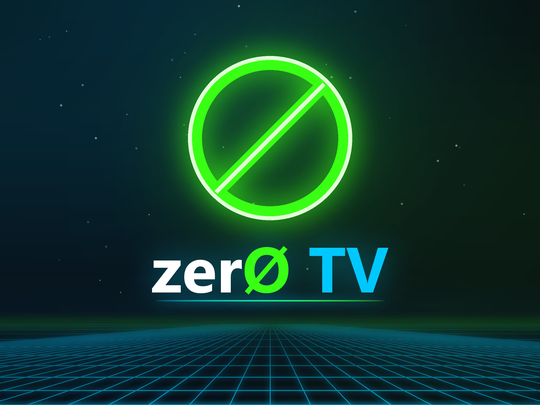
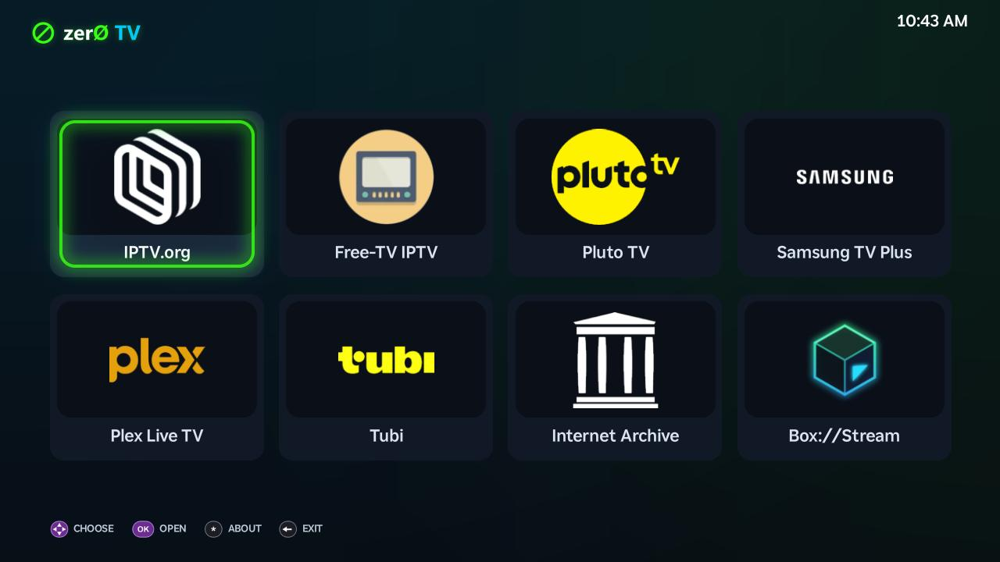
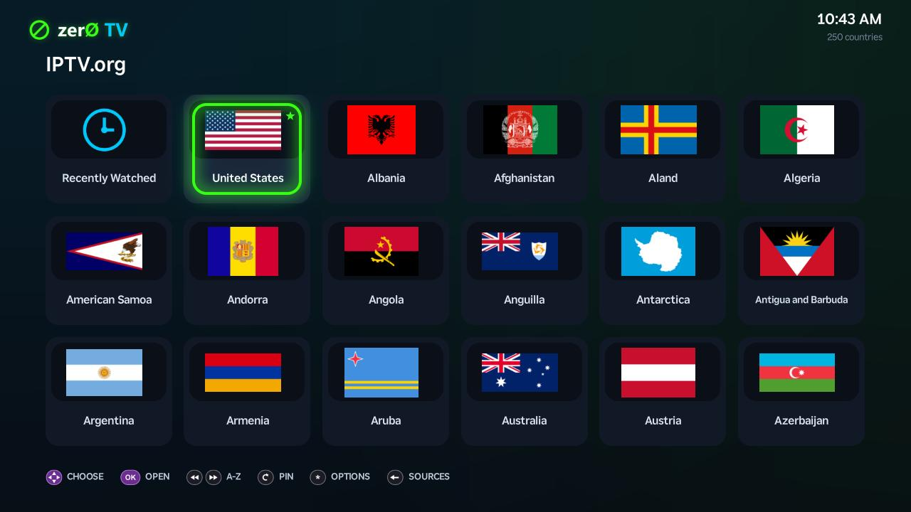
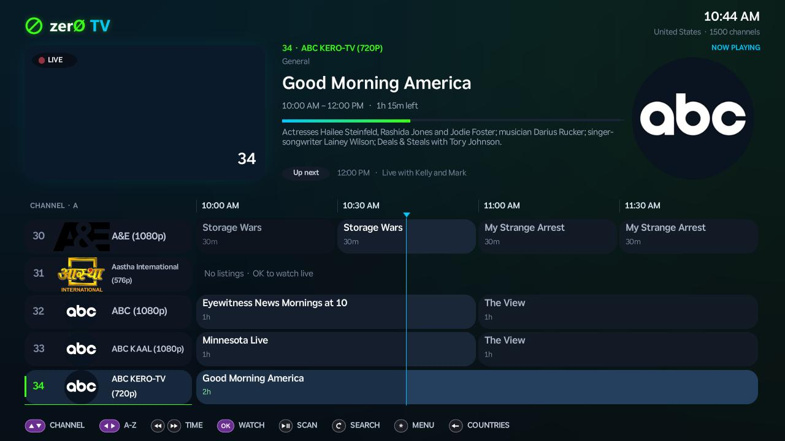
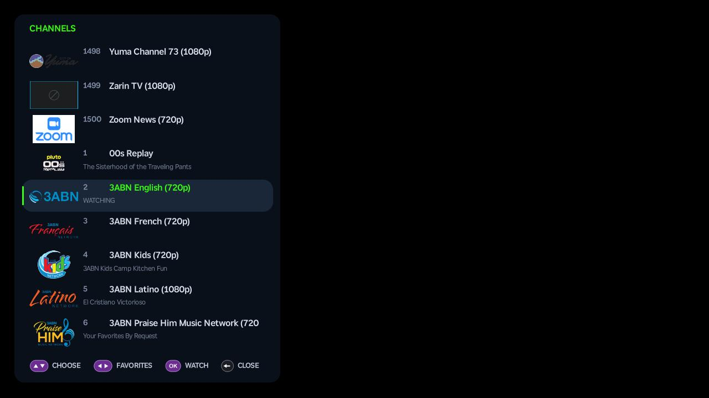
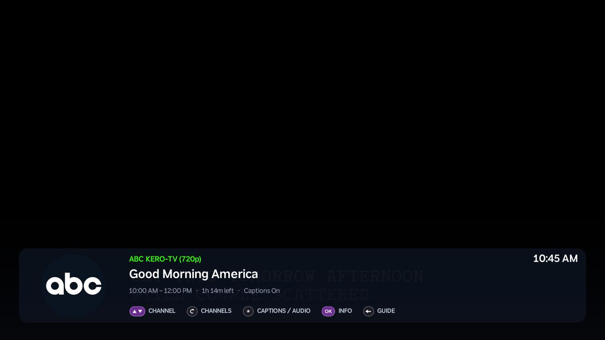
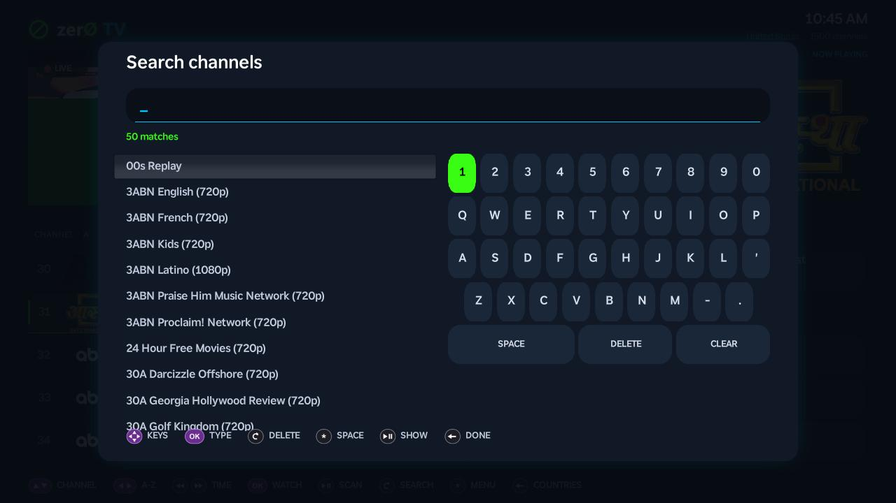
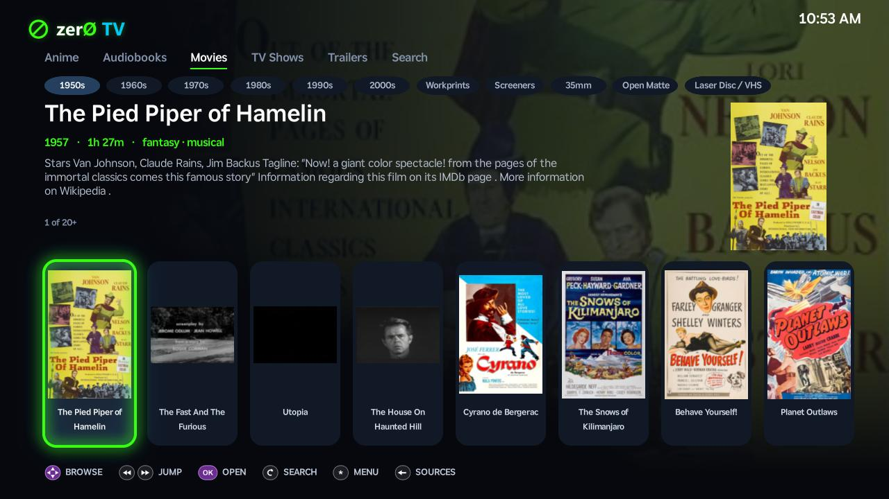
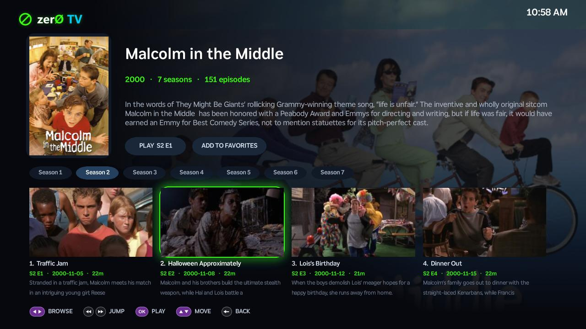

<h1 align="center">zerØ TV</h1>

<strong>Live TV, the Internet Archive and your own media library on Roku</strong>

Version 2.5.7 · 1080p · Live guides for 88 countries

zerØ TV brings free live TV from around the world, the whole Internet Archive and your own seedbox or home-server library together in one app. Pick a country and watch live with a full programme guide, browse films, TV seasons, anime and audiobooks found on the Archive as you go, or open Box://Stream to play your own collection.

## Download and install

| Package | What you get | Download |
| --- | --- | --- |
| **Roku ZIP** | The sideloadable app; upload this ZIP directly to your Roku | [zer0tv-v2.5.7-roku.zip](https://github.com/snuffy420/zer0TV/releases/download/v2.5.7/zer0tv-v2.5.7-roku.zip) |
| **Source 7z** | BrightScript, artwork, build tools, tests and documentation | [zer0tv-v2.5.7-source.7z](https://github.com/snuffy420/zer0TV/releases/download/v2.5.7/zer0tv-v2.5.7-source.7z) |

Checksums sit beside both downloads on the [release page](https://github.com/snuffy420/zer0TV/releases/tag/v2.5.7). The Roku installer needs the Roku ZIP; the source archive is for development.

### Install on Roku

1. Enable Developer Mode: press **Home** three times, **Up** twice, then **Right, Left, Right, Left, Right**. Follow the TV prompts, set an installer password, and note the Roku IP address.
2. From a computer on the same network, open `http://ROKU_IP` in your browser.
3. Sign in as `rokudev` using your installer password.
4. Select **Upload**, choose `zer0tv-v2.5.7-roku.zip`, then select **Install**.
5. Open zerØ TV and choose a source. Reinstalling replaces the existing sideloaded app.

See [Roku's developer setup](https://developer.roku.com/docs/developer-program/getting-started/developer-setup.md) for the official instructions.

## Sources

| Source | What you get |
| --- | --- |
| **IPTV.org** | Free live channels for 250 countries and regions, with programme guides |
| **Free-TV IPTV** | Curated free-to-air channels by country, plus News, Business, Weather, Music and VOD groups |
| **Pluto TV, Samsung TV Plus, Plex Live TV, Tubi** | US live channels with their own matching guides |
| **Internet Archive** | Films, full TV seasons, anime, audiobooks and 35mm trailers, found live on the Archive |
| **Box://Stream** | Your own movies, shows and music from a seedbox or home server |

## Live TV

### Countries

Every country is a flag card. Countries you open are pinned to the top automatically, so your usual lineup is always first; **Replay** pins or unpins one yourself, and **Recently Watched** keeps the channels you last tuned.

### The guide

A live preview and the current programme sit above a five-row rolling guide. Programmes that started earlier show an arrow, the thin now line runs across the grid, and each channel keeps its logo and number. **Left/Right** jumps through the alphabet, **REW/FF** moves through time, **OK** watches full screen and **Play** starts Scan, which rolls through the lineup and previews a channel every 45 seconds. Channels without listings stay in the guide and play normally.

Listings for IPTV.org and Free-TV come from this repository: a GitHub Action rebuilds every country's guide every six hours from every free XMLTV feed it can find (IPTV-EPG.org, epg.pw and epgshare01's country and service feeds) and matches them to each playlist's channels, including local stations by call sign. The US guide covers more than 750 channels. The Roku downloads only the country you open, and keeps it for 30 minutes so reopening is instant. See [EPG setup](docs/EPG_GUIDE.md).

### Full screen

**Up/Down** flips channels and **Replay** opens a channel panel on top of the picture, with what's on now for each channel. The information banner shows the programme, time left and the remote buttons, then fades.

| Channel panel | Information banner |
| --- | --- |
|  |  |

Search any lineup with **Replay** in the guide; the keyboard is a full QWERTY layout.

## Internet Archive

Everything is found live on the Archive as you browse; there is no built-in title list. Rows scroll endlessly and keep loading more.

- **Movies**: by decade from the 1950s to the 2000s (films of an hour or more), plus **Workprints**, **Screeners**, **35mm**, **Open Matte** and **Laser Disc / VHS**. Copies of the same film are grouped as versions (35mm, VHS, open matte, regular copy), with DVD extras alongside.
- **TV Shows**: items holding full seasons, several seasons in one item included. Each show gets its background, logo, and real episode titles, air dates, descriptions and pictures where TVmaze knows the show.
- **Anime**: Movies and TV Shows, with English titles and covers from AniList.
- **Audiobooks**: books as chapters, ready to play.
- **Trailers**: 35mm trailer scans.
- **Favorites**: anything you mark from the * menu.
- **Search**: choose Movies, TV Shows or Everything, then type on the QWERTY keyboard.

Every film and show opens one page, laid out like Box://Stream: poster, logo or title, facts, plot and buttons, then the seasons and a row of episode cards, or a film's versions and extras.

 An **Adult** section is off unless you switch it on in the * menu; adult items stay out of every other section.

Titles, versions and runtimes come from what uploaders publish. Availability and rights are handled by the Internet Archive; items that are removed there disappear here too.

## Box://Stream

The full [Box://Stream](https://github.com/snuffy420/BoxStream) app is built in unchanged: browse and play your own movies, TV shows and music from a seedbox or home server. A Roku keeps one sideloaded app at a time, and sideloaded apps share their saved settings, so if you used standalone Box://Stream before, your server sign-in and preferences carry over. **Back** from its home returns to zerØ TV.

## Controls

| Screen | Remote |
| --- | --- |
| **Sources** | Arrows choose · **OK** open · **\*** About · **Back** exit |
| **Countries** | Arrows browse · **OK** open · **REW/FF** A–Z · **Replay** pin · **\*** options · **Back** sources |
| **Guide** | **Up/Down** channels · **Left/Right** A–Z · **REW/FF** time · **OK** watch · **Play** Scan · **Replay** search · **\*** menu · **Back** countries |
| **Live, full screen** | **Up/Down** channel · **Replay** channel panel · **OK** information · **\*** captions/audio · **Back** guide |
| **Channel panel** | **Up/Down** choose · **Left/Right** favorites · **OK** watch · **Back** close |
| **Internet Archive** | **Left/Right** browse · **REW/FF** jump · **Up** sections · **OK** open · **Replay** search · **\*** menu · **Back** sources |
| **Title page** | **Left/Right** choose · **Up/Down** buttons, seasons, episodes · **REW/FF** jump · **OK** select · **Play** play · **Back** browse |
| **Film playback** | **Left/Right** 10 seconds · **REW/FF** 1 minute · **OK** seek · **Play** pause · **\*** audio/captions · **Back** browse |

Caption and audio choices depend on the tracks a stream supplies.

[More screenshots](docs/screenshots/2.5.7/README.md)

## Development and license

[Building](docs/BUILDING.md) covers packaging, the Box://Stream bundle and the automated checks. [Release notes](CHANGELOG.md) list every change. [Sources and data flow](docs/SOURCES.md) lists every feed, service and credit.

zerØ TV's application code is licensed under [GPL-3.0](LICENSE). Upstream playlists, schedules, metadata, artwork and video keep their own terms. See [THIRD_PARTY.md](THIRD_PARTY.md).

## Support zerØ TV

If zerØ TV is useful to you, consider supporting its development with a Bitcoin donation. Donations are optional and appreciated.

**Bitcoin (BTC):**
`bc1qz8877p6vusc22qrctdj4h7w0uk2l9l9h8lwphy`

You can also scan the QR code in **About**.

## Contact

Questions, feedback, a bug report or a custom build? Get in touch through the zerØ TV contact form.

  

