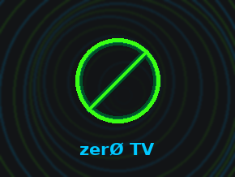
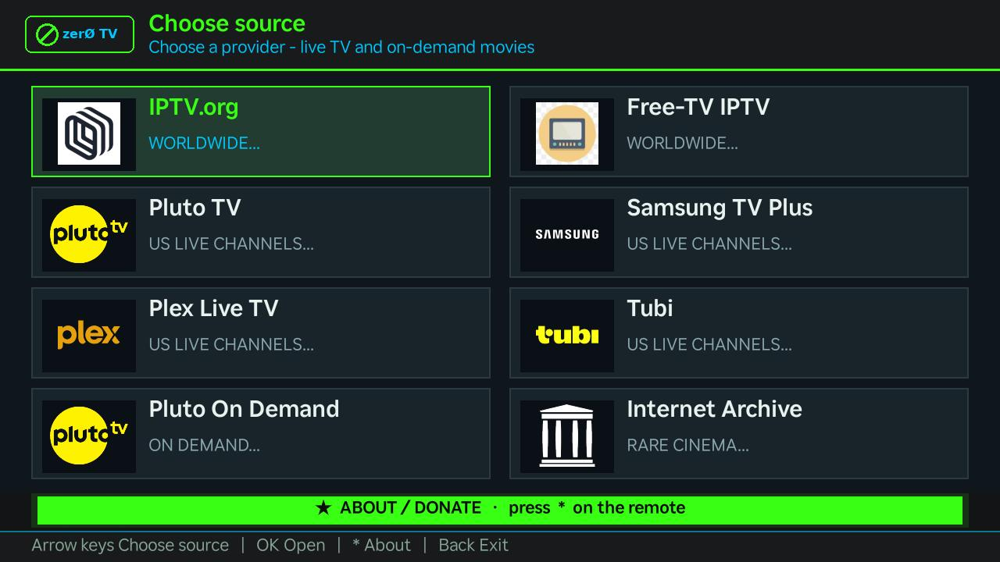
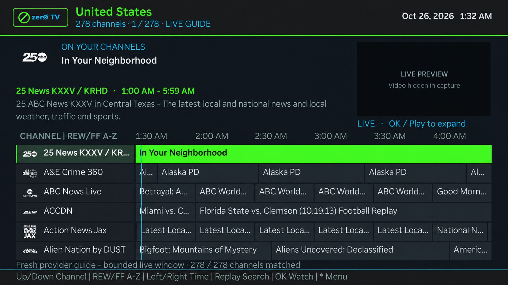
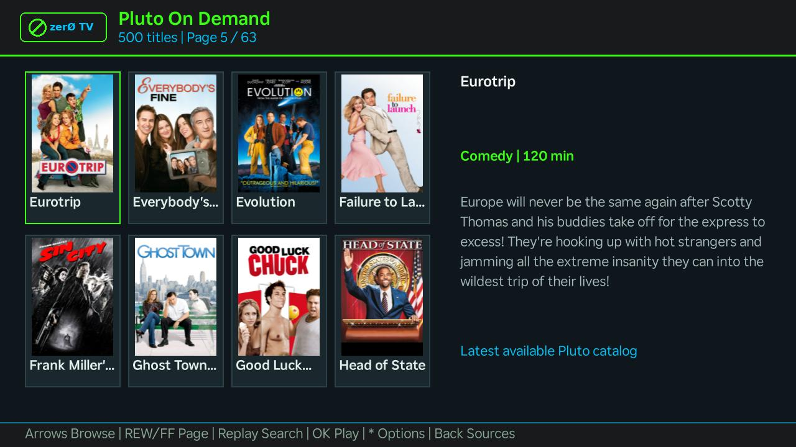
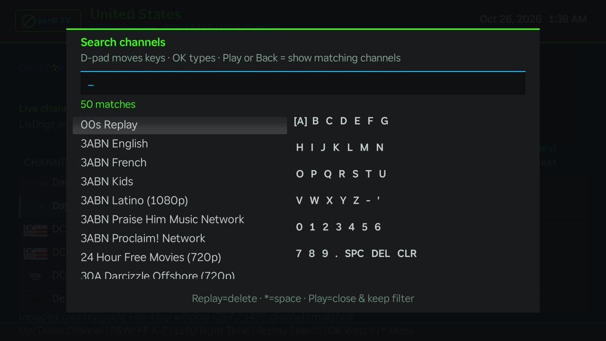
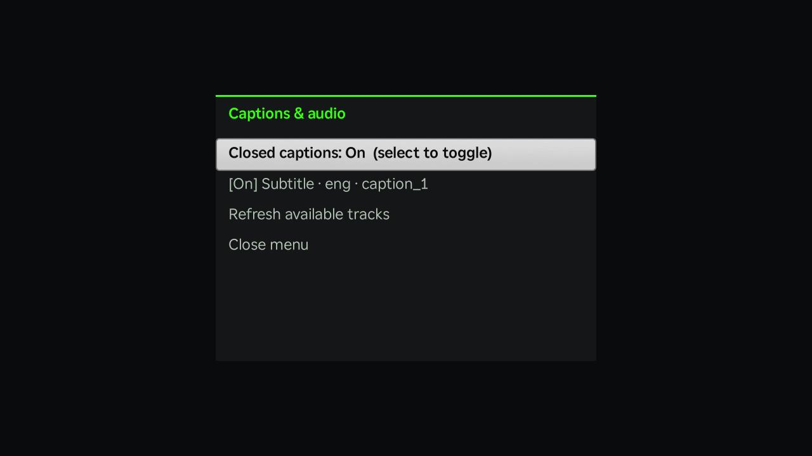

<h1 align="center">zerØ TV</h1>

<strong>Live TV and on-demand discovery for Roku</strong>

Country guides · Live preview · Rare cinema · Version 1.5.0

zerØ TV brings public live-channel playlists and on-demand catalogs together in a dark neon interface. Browse by country, preview a channel in the guide, search for something to watch, or discover films and alternate cuts on Internet Archive.

<em>Eight source choices, one familiar remote. Actual zerØ TV 1.5.0 Roku capture.</em>

## Download and install

| Package | What you get | Download |
| --- | --- | --- |
| **Roku ZIP** | The sideloadable app; upload this ZIP directly to your Roku | [zer0tv-v1.5.0-roku.zip](releases/zer0tv-v1.5.0-roku.zip) |
| **Source 7z** | Editable BrightScript, artwork, build tools and documentation | [zer0tv-v1.5.0-source.7z](releases/zer0tv-v1.5.0-source.7z) |

Checksums sit beside both downloads in [releases](releases). The source archive is for development; the Roku installer needs the Roku ZIP.

### Install on Roku

1. Enable Developer Mode: press **Home** three times, **Up** twice, then **Right, Left, Right, Left, Right**. Follow the TV prompts, set an installer password, and note the Roku IP address.
2. From a computer on the same network, open `http://ROKU_IP` in your browser.
3. Sign in as `rokudev` using your installer password.
4. Select **Upload**, choose `zer0tv-v1.5.0-roku.zip`, then select **Install**.
5. Open zerØ TV and choose a source. Reinstalling replaces the existing sideloaded app.

See [Roku's developer setup](https://developer.roku.com/docs/developer-program/getting-started/developer-setup.md) for the official instructions.

## Explore zerØ TV

### A guide built for channel browsing

See what's on now and next, keep channel logos in view, and inspect programme details without leaving the lineup. Pause on a channel to start the live preview, then press **OK** to expand it. **REW/FF** jumps by letter, **Replay** opens search, and channels without matching listings stay visible and playable.

<em>Tubi's live guide on Roku. The preview area was edited to remove a capture artifact; Roku video playback is not shown.</em>

### Movies with posters and details

Pluto On Demand uses a poster grid with descriptions and available runtime/category information. Browse pages with **REW/FF**, search with **Replay**, and press **OK** to watch. Internet Archive uses the same browser with rare-find, workprint, alternate-cut, trailer and behind-the-scenes discovery filters.

<em>Pluto On Demand on Roku. Catalog titles and availability change with the upstream feed.</em>

### Search, captions and familiar playback controls

Search channels with the on-screen keyboard, toggle closed captions from **Options (*)**, or select an available subtitle/audio track. A translucent channel-information banner sits at the bottom of the picture and fades automatically. Country pins and recently visited countries help you return to a lineup quickly.

| Channel search | Captions and available tracks |
| --- | --- |
|  |  |

[View the full screenshot gallery](docs/screenshots/1.5.0/README.md), including country history, the playback banner and the versioned splash. Captures are from a real Roku; video areas can be blank or corrupted because the screenshot utility does not capture the video plane.

## Live TV and movie sources

| Source | What you can browse | Playlist / catalog project |
| --- | --- | --- |
| **IPTV.org** | Worldwide live country playlists | [iptv-org/iptv](https://github.com/iptv-org/iptv) |
| **Free-TV IPTV** | Curated live channels grouped by country | [Free-TV/IPTV](https://github.com/Free-TV/IPTV) |
| **Pluto TV** | US live channels with matching EPG | [BuddyChewChew/app-m3u-generator](https://github.com/BuddyChewChew/app-m3u-generator) |
| **Samsung TV Plus** | US live channels with matching EPG | [BuddyChewChew/app-m3u-generator](https://github.com/BuddyChewChew/app-m3u-generator) |
| **Plex Live TV** | US live channels with matching EPG | [BuddyChewChew/app-m3u-generator](https://github.com/BuddyChewChew/app-m3u-generator) |
| **Tubi** | US live channels with matching EPG | [BuddyChewChew/tubi-scraper](https://github.com/BuddyChewChew/tubi-scraper) |
| **Pluto On Demand** | Movies and shows in the public US catalog feed | [OwnerPlugins/pluto-tv-m3u](https://github.com/OwnerPlugins/pluto-tv-m3u) |
| **Internet Archive** | Rare finds, workprints, alternate cuts and public movie files | [Internet Archive](https://archive.org/) |

**Schedule and artwork sources:** [IPTV-EPG.org](https://iptv-epg.org/guides) supplies the original country XMLTV inputs; [matthuisman/i.mjh.nz](https://github.com/matthuisman/i.mjh.nz) supplies matching Pluto/Samsung/Plex guides; the Tubi scraper publishes its own matching XMLTV. Pluto's public episode/image endpoints and Archive's search/metadata services provide movie details and posters. The [complete source register](docs/SOURCES.md) lists every feed, endpoint, guide path and artwork credit.

Internet Archive opens with rare finds. Press **Options (*)** to choose Workprints, Alternate cuts, Trailers, Behind the scenes or Public-domain-marked classics. **Replay** searches movie titles/subjects. These labels reflect uploader metadata; an item may be incomplete, mislabeled or unavailable. Restricted/private files are excluded, and playback requires a compatible public MP4.

## Controls

| Screen | Remote controls |
| --- | --- |
| **Sources** | Arrows choose a card; OK opens; * About; Back exits |
| **Countries** | Up/Down browse; Left/Right jump letters; Replay pin/unpin; * options; Back sources |
| **Live guide** | Up/Down channels; Left/Right timeline; REW/FF jump A–Z; Replay search; OK/Play full screen; * options |
| **Movies** | Arrows browse; REW/FF page; Replay search; OK/Play watch; * search, refresh and Archive filters |
| **Playing** | Play pause/resume; OK information banner; * captions/audio; Back guide or movie browser |
| **Movie seeking** | Left/Right 10 seconds; REW/FF 60 seconds |

Caption and audio choices depend on tracks supplied by the stream. The translucent information banner sits at the screen bottom and fades automatically.

## Fresh playlists and guides

Playlists and movie catalogs fetch when their source or country opens. Pluto, Samsung, Plex and Tubi guides fetch matching XMLTV directly; no hosting setup is needed for those entries. Movie posters and details load as you browse, and playback files are checked again when selected. Small network fallback caches last for the current app session. Favorites, preferences and country history are saved separately.

**IPTV.org and Free-TV country EPG updates use this repository.** The app is already configured for `snuffy420/zer0TV/main/epg/data`. After uploading the repository files, open **Actions → Update country guides → Run workflow** once. The included workflow then refreshes the configured US, UK, Canadian and Australian guides every six hours. GitHub Actions must be enabled with permission to write repository contents. Bundled snapshots are a temporary fallback and expire after 24 hours; ongoing listings depend on successful workflow runs. No manual JSON editing is needed.

Guide coverage, titles and streams depend on upstream availability and regional restrictions. Pluto On Demand shows the public feed's selection, which may be smaller than Pluto's complete catalog. The Tubi entry is live TV; it does not include Tubi's on-demand movie library. The app does not host or record video. See [guide setup](docs/EPG_GUIDE.md), the [complete source register](docs/SOURCES.md) and [third-party notices](THIRD_PARTY.md).

## Development and license

The source includes reusable guide rows, thumbnail-sized artwork, background workers and serialized playback transitions to keep browsing responsive. [Build instructions](docs/BUILDING.md) cover packaging and automated checks. [Release notes](CHANGELOG.md) describe 1.5.0.

zerØ TV's application code is licensed under [GPL-3.0](LICENSE). Upstream playlists, schedules, movie metadata, artwork and video retain their respective terms. See [THIRD_PARTY.md](THIRD_PARTY.md).

## Support zerØ TV

If zerØ TV is useful to you, consider supporting its development with a Bitcoin donation. Donations are optional and appreciated.

**Bitcoin (BTC):**
`bc1qz8877p6vusc22qrctdj4h7w0uk2l9l9h8lwphy`

You can also scan the QR code in **About**.

## Contact

Questions, feedback, a bug report or a custom build? Get in touch through the zerØ TV contact form.

  

