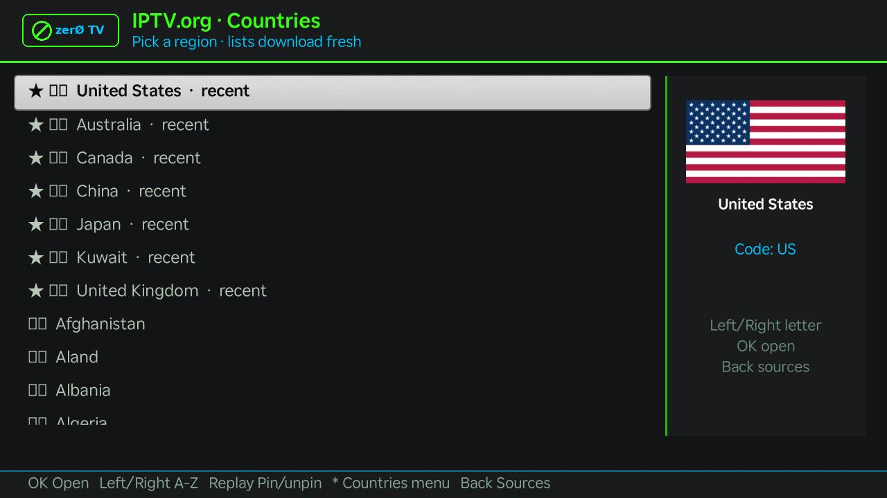
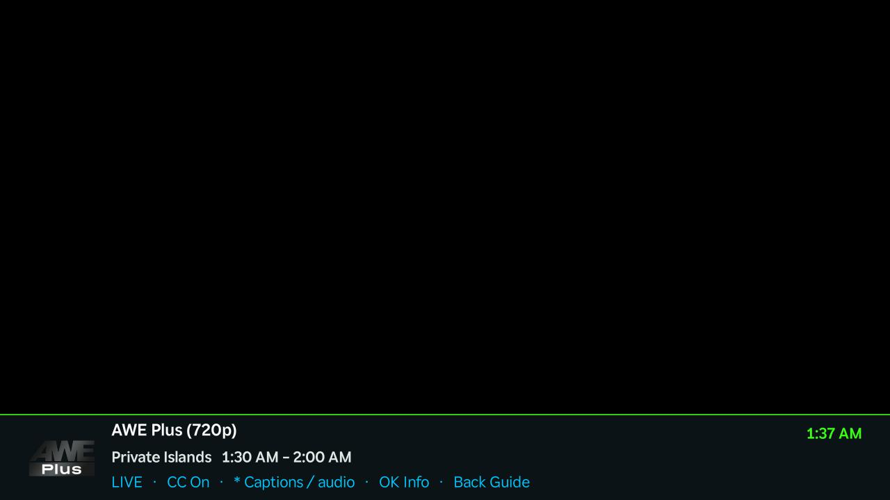
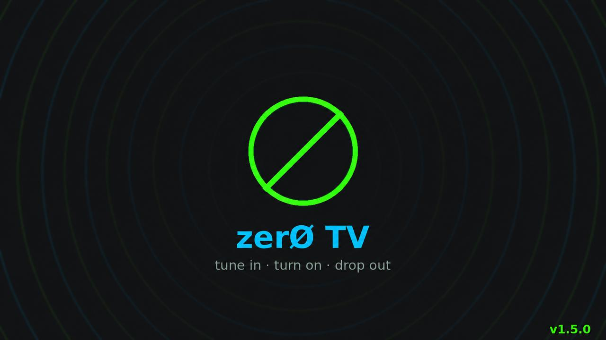

# zerØ TV 1.5.0 screenshots

These captures were supplied from the running Roku app. Click an image to view its full size. Original JPEGs are kept without recompression. UI counts and catalog contents reflect the capture session, not a fixed catalog guarantee.

The Roku screenshot utility omits the video plane. Blank or corrupted video areas in captures do not show what the TV displayed during playback. The featured EPG image has an edited dark preview panel to remove that capture artifact; no show image was inserted. The [original EPG capture](../../../assets/screenshot-guide-original.jpg) is retained for reference, and [capture metadata](captures.json) identifies the derivative.

## Source selection

IPTV.org, Free-TV, Pluto TV, Samsung TV Plus, Plex, Tubi, Pluto On Demand and Internet Archive.

## Live EPG

Tubi's US guide with all 278 channels matched at capture time. The video-preview capture artifact was replaced by a labeled dark panel for documentation.

## On-demand movies

Eight posters per page, focused-title metadata and remote paging/search controls.

## Countries, pins and recent history

Country history and persistent pins keep visited lineups near the top. This is the original device capture, including the device's font rendering.

## Channel search

The remote operates the keyboard and matching-channel list.

## Playback information banner

The fading banner shows channel, programme, time and control hints. The large black region is the video plane excluded by Roku capture, not an inserted replacement show frame.

## Captions and audio

Closed-caption toggle and available subtitle tracks. Track availability depends on the selected stream.

## Splash

The final splash displays 1.5.0 without a test label.

[Back to the main README](../../../README.md)
