# zerØ TV 2.5.7 screenshots

Captured on a Roku from the running app. The Roku screenshot tool doesn't capture the video layer, so video areas show as black or empty; closed captions from the channel can show faintly behind the banner. Channel counts and titles are what the sources had at capture time.

## Sources

[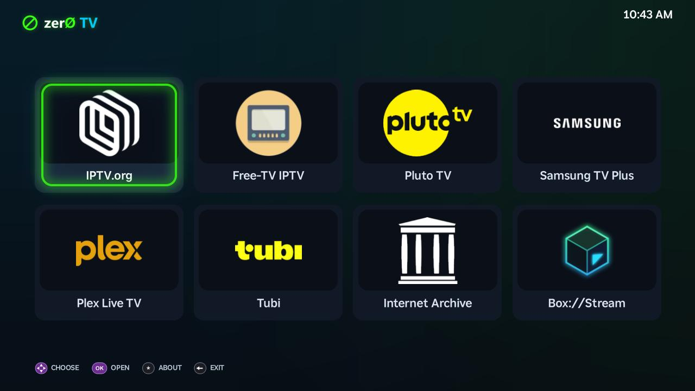](../../../assets/screens/sources.jpg)

## Countries

IPTV.org, with the United States pinned after opening it:

[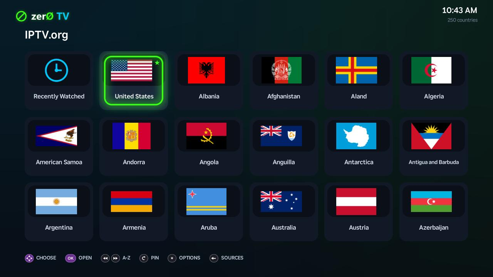](../../../assets/screens/countries.jpg)

Free-TV, every country with its flag:

[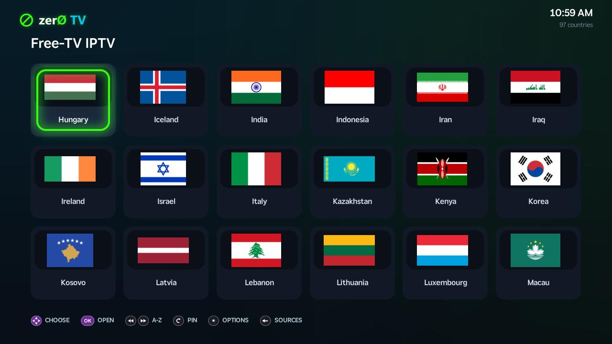](../../../assets/screens/freetv.jpg)

## Live guide

The US guide with A&E and ABC stations, now matched to their listings:

[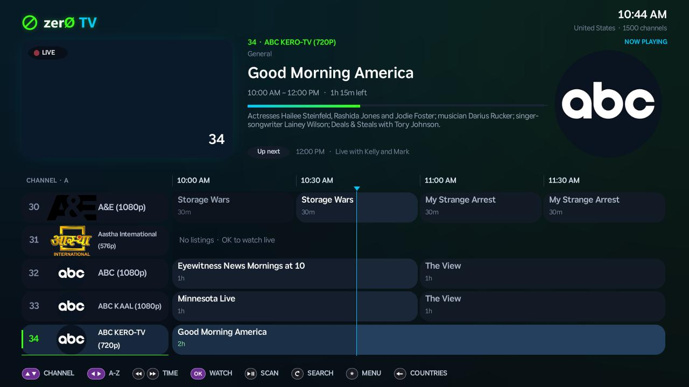](../../../assets/screens/guide.jpg)

## Full screen

The channel panel (Replay) and the information banner:

[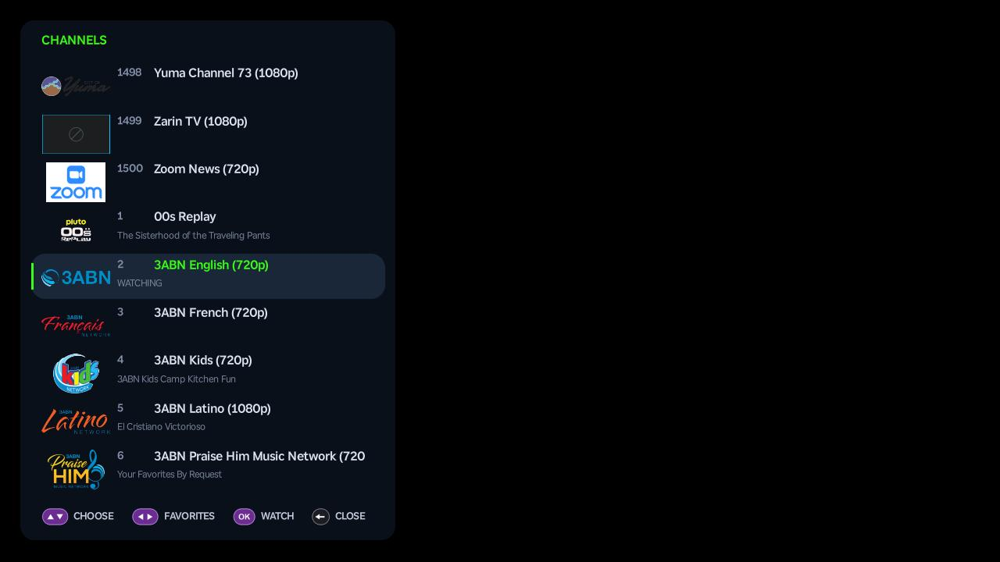](../../../assets/screens/quick.jpg)

[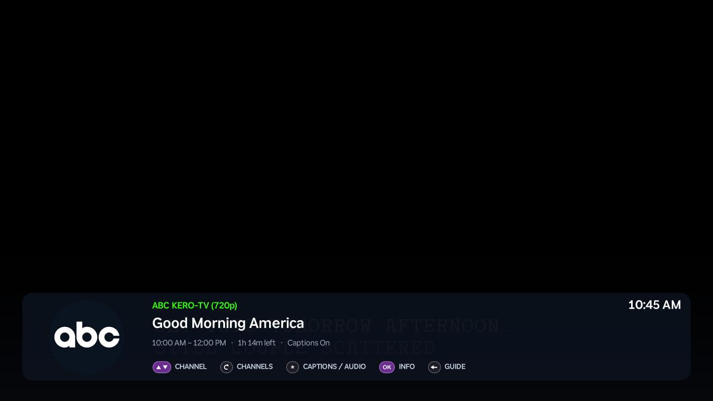](../../../assets/screens/banner.jpg)

## Channel search

[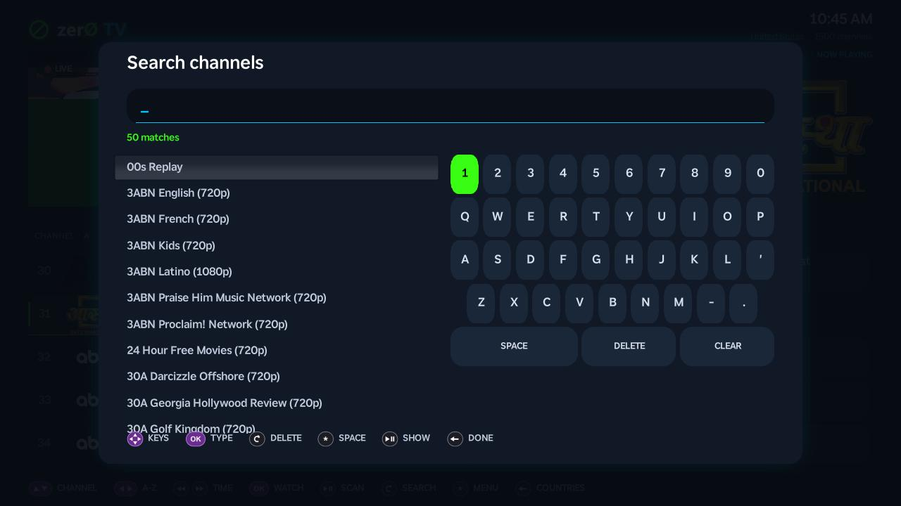](../../../assets/screens/search.jpg)

## Internet Archive

Movies by decade, with the special-edition chips:

[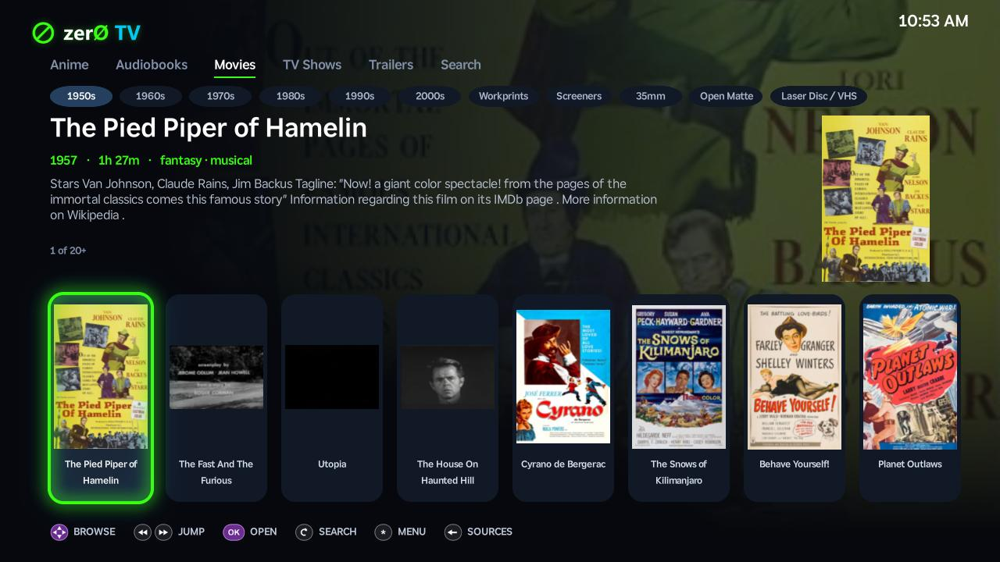](../../../assets/screens/archive.jpg)

A TV show page, choosing a season and an episode:

[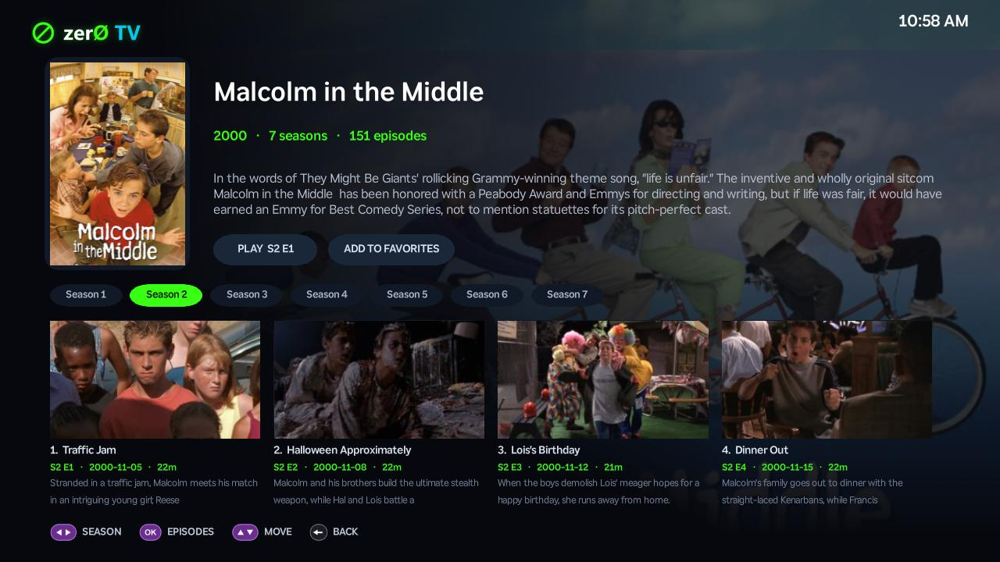](../../../assets/screens/show-seasons.jpg)

[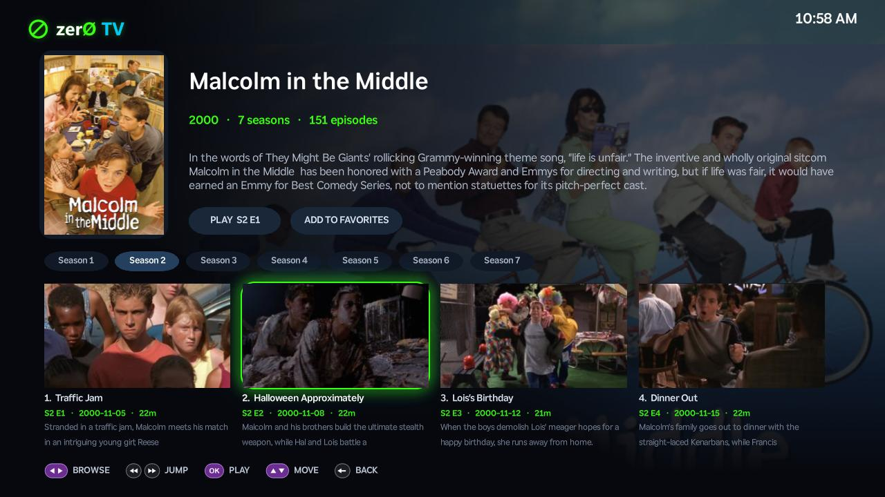](../../../assets/screens/show.jpg)

## Splash

[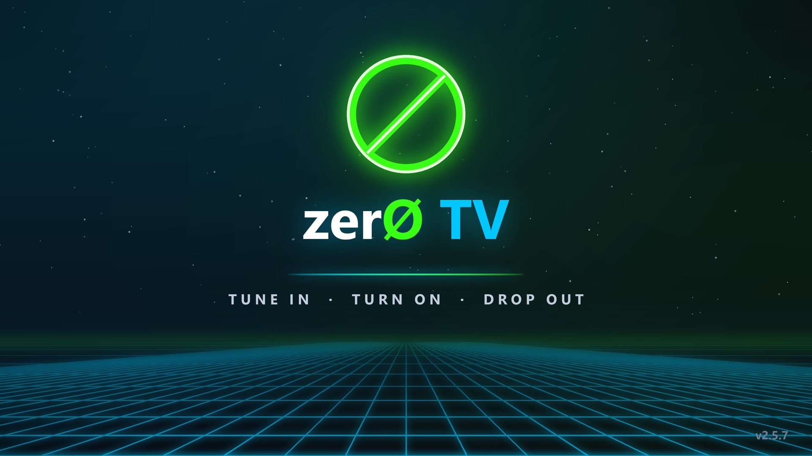](../../../assets/screens/splash.jpg)
